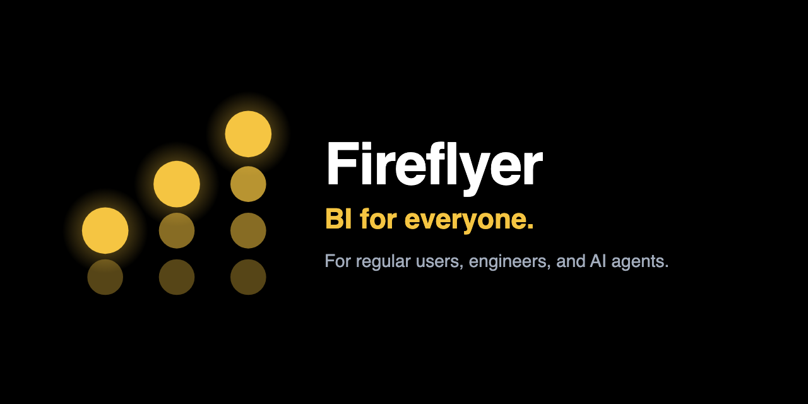
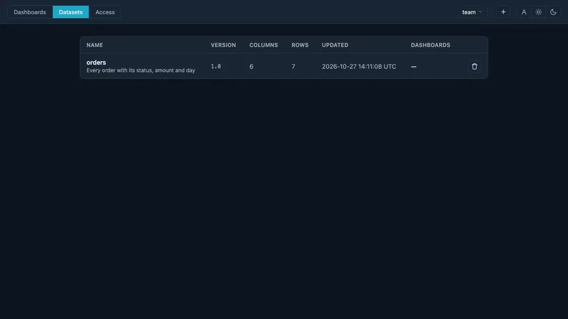

<p align="center">
  
</p>

<p align="center">
  <a href="https://github.com/dankor/fireflyer/actions/workflows/ci.yml"></a>
  
  <a href="#license"></a>
</p>

<p align="center">
  <a href="#quickstart">Quickstart</a> ·
  <a href="docs/use-cases.md">Use cases</a> ·
  <a href="architecture.md">Spec</a> ·
  <a href="CHANGELOG.md">Changelog</a>
</p>

# Fireflyer

Turn a CSV into an interactive dashboard: build it by clicking, write it as YAML, or ask the AI. It runs on your machine with one command, and every dashboard is a single file you can commit.



## Quickstart

```bash
git clone https://github.com/dankor/fireflyer.git
cd fireflyer
docker compose up --build
```

Open <http://127.0.0.1:8000>. A demo dashboard is waiting, with its sample data in the file, so there's nothing to upload first.

**Optional — the AI assistant.** It runs on Claude. Put your key in `.env` and restart:

```bash
cp .env.example .env    # then set ANTHROPIC_API_KEY=sk-ant-...
```

Without a key everything else works; the chat just shows how to turn it on. The key stays on the server and never reaches the browser.

<details>
<summary>Run without Docker (Python 3.11+)</summary>

```bash
git clone https://github.com/dankor/fireflyer.git
cd fireflyer
python -m venv .venv && source .venv/bin/activate
pip install -e .
python -m fireflyer.web        # editor at http://127.0.0.1:8000
```

</details>

## Three ways to build a dashboard

One engine, three ways in, and you can switch at any time. They all edit the same YAML file.

### 🎨 Build it in the UI

For everyone. Add charts from a menu, fill in a short form, drag rows and columns to resize. Nothing to memorize, and every click is written back as clean YAML.


### </> Write it in code

For engineers. A whole dashboard is one YAML file in your editor and in git, with completion and linting in the browser too. Review it as a diff, script it, ship it like any other code.


### 🤖 Ask the AI

For anyone in a hurry. *"Add a table of orders."* *"Put the pie next to it."* *"Make the top row taller."* The assistant writes the same YAML and checks every change before applying it.


## What's inside

- **Five chart types** — table, pie, bar, map (a hex heatmap over OpenStreetMap) and number.
- **Calcs** — sums, counts, averages and ratios, defined once and shared by every chart. [How →](docs/use-cases.md#create-a-dashboard-with-code)
- **Filters** — fixed per chart, [click-to-filter across charts](docs/use-cases.md#filter-with-a-cross-filter), [global](docs/use-cases.md#filter-with-a-global-filter), and [per role](docs/use-cases.md#filter-with-a-role).
- **Datasets** — [upload a CSV](docs/use-cases.md#upload-a-dataset), shape its columns with formulas, keep every version and [compare them](docs/use-cases.md#compare-dataset-versions).
- **Access** — roles, [per-dataset permissions](docs/use-cases.md#set-dataset-permissions) with row filters, and a "view as" picker to preview what a role sees.
- **History** — every save is a version; [compare any two](docs/use-cases.md#compare-versions) side by side.
- **Private by design** — the AI sees your column names and types, never your data.
- **Prototype on fake data** — ask the AI for sample data and it [writes it into the dashboard](docs/use-cases.md#prototype-a-dashboard-with-ai-and-sample-data).
- **No build, no CDN** — the editor's scripts ship in the repo and work offline; only the map's tiles come from OpenStreetMap.

Every feature, step by step with a recording: **[use cases](docs/use-cases.md)**.

## A dashboard is one YAML file

```yaml
name: Orders overview

charts:
  orders_table:
    type: table
    dataset: orders          # a dataset, by name
    title: Orders

  status_pie:
    type: pie
    dataset: orders
    title: Orders by status
    column: status

  total_orders:
    type: number
    dataset: orders
    title: Total orders

layout:
  - Overview                                    # a header
  - ["@40", "orders_table:60", "status_pie:40"] # a row: @height, then chart:width
  - "-"                                         # a separator
  - ["@30", "total_orders:100"]

datasets:                    # optional: sample data carried in the file
  orders: |
    id,status,amount
    1,paid,42
    2,pending,15
```

Paste it into the editor's code mode and it renders. Widths are proportions, so `1:1:1` is three equal columns. Charts name their dataset, never a file path: either one you uploaded, or one written into the file like the `datasets:` block above, which is handy for prototyping. Each chart's options are in its spec, [`fireflyer/chart/<type>/spec.md`](fireflyer/chart), and the full layout and filter rules are in [`architecture.md`](architecture.md).

## Dashboards as code

Because a dashboard holds no data, it's just code: keep it in git and review changes in pull requests. With Docker, each host folder you mount under `/paths` becomes a **path** you can switch between in the gallery, each with its own dashboards and datasets. No database, no login:

```yaml
# docker-compose.yml
volumes:
  - ./paths:/paths                      # your own paths (gitignored)
  - ./demo:/paths/demo                  # the demo path: the repo's demo/ folder
  - /Users/me/team-a:/paths/team-a      # any folder can be a path
```

A path's dashboards are `<path>/dashboards/*.yaml`, files you own and commit. Datasets you upload are stored separately for each path, and dashboards refer to them by name, so the same YAML works anywhere that data exists.

**Next up:** a command-line tool and API to deploy dashboards to a running instance when a pull request merges.

## Development

```bash
pip install -e ".[test]"
pytest                       # the snapshot suite
UPDATE_SNAPSHOTS=1 pytest    # regenerate snapshots after an intentional change

docker compose run --rm fireflyer pytest   # or in the container
```

Tests compare the **exact** HTML each chart and dashboard renders against `tests/snapshots/`; after an intentional change, regenerate them and review the diff. With Docker the source is mounted with hot reload, so edits show up live.

Contributions are welcome. Keep the code approachable: small functions, clear names, comments that explain *why*. [`CLAUDE.md`](CLAUDE.md) has the conventions, for humans and agents alike.

## License

Source-available under [Apache-2.0 with the Commons Clause](LICENSE): use it, change it, run it for your own work, but don't sell it or offer it as a paid hosted service. For a commercial license, see the [LICENSE](LICENSE) file.

---

<p align="center"><sub><i>Fire, walk with me.</i></sub></p>
