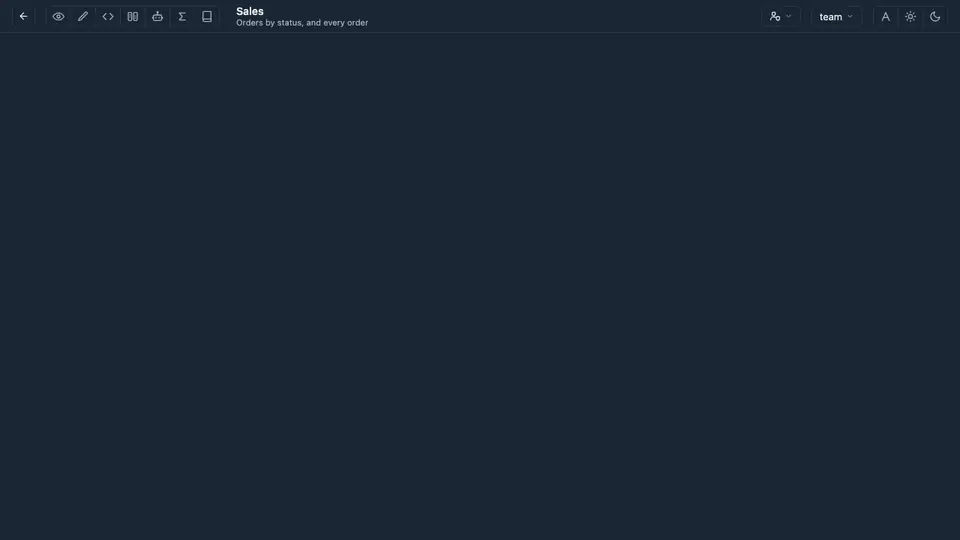
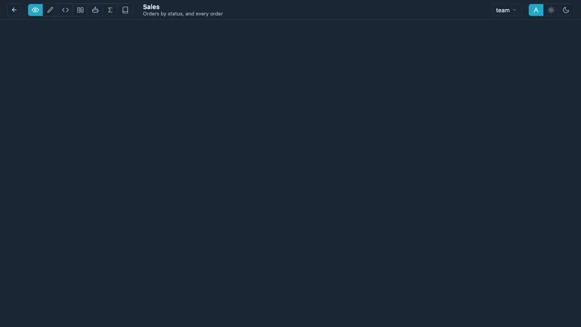
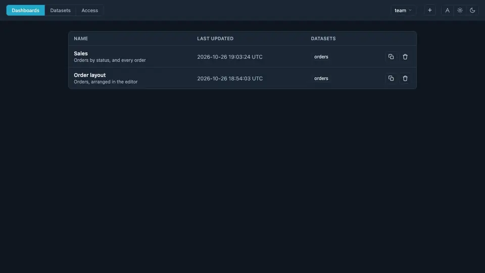

# Use cases

These use cases show how you'd actually work with Fireflyer, step by step — and
how little it takes to build a dashboard. Each one is a short explanation and a
video of it being done, from a blank page to a finished dashboard.

You can build the same dashboard three ways: click it together, write it as
YAML, or ask the AI. Pick whichever feels easiest and switch at any time —
they all edit the same file.

Every example uses one small sample dataset: a list of orders, each with its
status, amount and day.

## Contents

- [Dashboard](#dashboard)
  - [Create a dashboard with UI](#create-a-dashboard-with-ui)
  - [Create a dashboard with code](#create-a-dashboard-with-code)
  - [Create a dashboard with AI](#create-a-dashboard-with-ai)
  - [Arrange the layout with UI](#arrange-the-layout-with-ui)
  - [Arrange the layout with code](#arrange-the-layout-with-code)
  - [Arrange the layout with AI](#arrange-the-layout-with-ai)
  - [Filter with a built-in filter](#filter-with-a-built-in-filter)
  - [Filter with a cross-filter](#filter-with-a-cross-filter)
  - [Filter with a global filter](#filter-with-a-global-filter)
  - [Filter with a role](#filter-with-a-role)
  - [Compare versions](#compare-versions)
- [Datasets](#datasets)
  - [Upload a dataset](#upload-a-dataset)
  - [Edit columns with UI](#edit-columns-with-ui)
  - [Edit columns with code](#edit-columns-with-code)
  - [Compare dataset versions](#compare-dataset-versions)
  - [Set dataset permissions](#set-dataset-permissions)
- [End-to-end](#end-to-end)
  - [Prototype a dashboard with AI and sample data](#prototype-a-dashboard-with-ai-and-sample-data)
  - [Let the AI discover your dataset and build the dashboard](#let-the-ai-discover-your-dataset-and-build-the-dashboard)

## Dashboard

### Create a dashboard with UI

A dashboard is one YAML file: its charts, the calcs they count with, and the
layout. Build it by clicking in the editor, by writing the YAML, or by asking
the assistant — all three edit the same file, so you can switch at any time.

Make a new dashboard, then click the big **+** to add its first chart: pick the
dataset as you type, add a calc that counts the orders, put a pie beside the
table, and save.


### Create a dashboard with code

Open **code** mode and write the dashboard as YAML — keys, datasets, columns
and calcs complete as you type — then refresh the preview and save.

```yaml
name: Orders from YAML
description: Orders at a glance
calcs:
  orders:
    n: {agg: count, name: Orders, description: Number of orders}
charts:
  total: {type: number, dataset: orders, calc: n, title: Orders, description: All orders}
  byStatus: {type: pie, dataset: orders, calc: n, column: status, title: By status, description: Orders per status}
  rows: {type: table, dataset: orders, title: Rows, description: Every order}
layout:
  - ["@24", "total", "byStatus"]
  - ["@40", "rows"]
```


### Create a dashboard with AI

Open **chat** mode and describe the dashboard you want. The assistant knows
your datasets' columns (never their data), writes the whole YAML, checks it,
and the preview updates at once; keep asking to refine it, then save.


### Arrange the layout with UI

Rows have a height, charts a width in their row, and the page can split into
tabs — change any of it by dragging, by editing the `layout:` YAML, or by
asking.

In **edit** mode, pull a row's bottom edge to make it taller and a column's
edge to make it wider; a chart's move button lights blue zones to drop it in.
The **+** between rows adds tabs, and the tab bar reorders them.


### Arrange the layout with code

Jump to `layout:` with its chip in **code** mode and write it: each row is
`["@height", "chart:width", …]`, and a mapping of names to rows makes tabs.

```yaml
layout:
  Summary:
    - ["@35", "byStatus:3", "total:2"]
  Details:
    - ["@44", "rows"]
```


### Arrange the layout with AI

Say how it should look in **chat** mode — which charts go together, which is
wider, what goes in which tab — and the assistant rewrites the layout.


### Filter with a built-in filter

Filters come from four places, and a chart's badge lists each one with its
source. A built-in filter is part of the chart itself: add it under
**Filters** in the chart's edit form (or `filters:` in its YAML), and the
chart always shows only those rows — here, every status but cancelled.



### Filter with a cross-filter

Click a slice or a bar to filter every other chart on the dashboard; click it
again to clear. The click rides in the page URL, so a link keeps it.


### Filter with a global filter

Open any chart's badge and type a filter in its bottom row — a column, an
operator and values, or a range — and it applies to the whole dashboard.
Edit or remove it from the same row.


### Filter with a role

Previewing the dashboard as a role (the role picker in view mode) adds that
role's filters from each dataset's permissions to every chart; they lead the
badge's list and can't be removed. Pick the role again to see everything.


### Compare versions

Every save is a version. Edit a chart, save, and open **diff** mode to see the
change line by line — and restore an older version if you need it back.



## Datasets

### Upload a dataset

Upload a CSV under **Datasets** with a name and a description; its page opens
on the columns it has, with example values.


### Edit columns with UI

Every column is a formula over the file you uploaded, so you can fix it without
touching the file. In **edit** mode, make a column a number with
`to_number()`, rename it, or hide it from dashboards with the crossed-out eye.
Saving builds the next version (1.0 → 1.1).


### Edit columns with code

The same columns as YAML in **code** mode: each one a name and a formula. Add
a line and you have a new computed column.

```yaml
  amount_cents:
    formula: to_number(amount) * 100
```


### Compare dataset versions

Every saved change is a version. **compare** shows two side by side; the
arrows step back and forth through them, and restore brings an old one back.


### Set dataset permissions

In **permissions**, list the roles that may read the dataset: all of it
(**Full**), or only the rows their filters let through. **Rows** shows how
many each role will see.


## End-to-end

### Prototype a dashboard with AI and sample data

Have an idea but no data yet? Describe the dashboard you want and ask the AI to
make up realistic sample data for it. It writes a small dataset into the
dashboard itself and builds the charts on top, so you can try the idea in a
minute and swap in real data later.



### Let the AI discover your dataset and build the dashboard

Upload your CSV, start a new dashboard and ask the AI to analyze the dataset
and build a dashboard for it. It sees your columns (never your data), picks the
totals, trends and breakdowns worth showing, and lays them out — ready to save,
or to refine by asking again.


